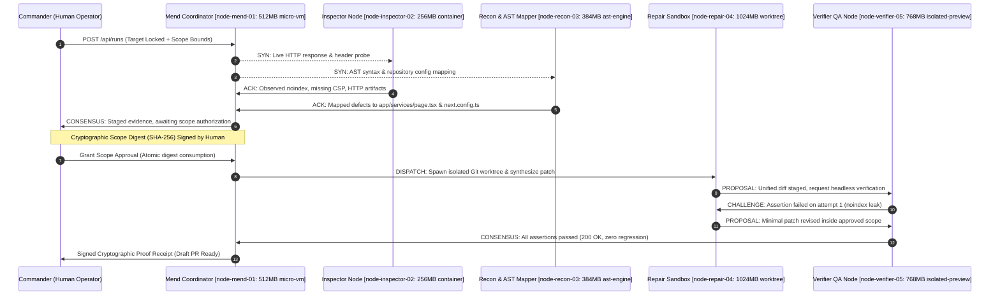

# TrustPatch

**Evidence before confidence. AI proposes. Sandboxes verify. Humans authorize.**

TrustPatch is a supervised-autonomous repair and security agent for production web applications and Git repositories. It connects deterministic security, technical SEO, and vulnerability evidence directly to source code, plans the smallest safe patch in isolated sandboxes, and verifies the patched application before requesting human authority.

Built by **Shaidan Shaari ([NusaByte](https://nusabyte.my))** for the **Meta Global AI Developer Hackathon** — **Startup Track · Build for Your World**.

| | |
|---|---|
| **Live Application** | [trustpatch.72.62.254.65.sslip.io](https://trustpatch.72.62.254.65.sslip.io) |
| **Local Workbench** | `http://localhost:7258` |
| **Repository** | [github.com/nusabyte-my/TrustPatch](https://github.com/nusabyte-my/TrustPatch) |
| **Protocol Specification** | [TAP-1 Agent Handshake Protocol (10.42.0.0/24)](docs/AGENT_PROTOCOL.md) |
| **Security Standards** | [OWASP Agentic Skills Top 10 (AST10) & MITRE ATLAS](docs/AGENT_SKILLS_SECURITY.md) |
| **Primary Planner** | Meta Model API (`muse-spark-1.3`, `muse-wonder`, `muse-glimmer`) & Llama family |
| **Target Isolation** | Ephemeral Git Worktrees + Container/MicroVM sandboxing |

---

## 1. Why TrustPatch

Traditional scanners and AI audits tell you **what might be wrong**, dumping massive checklists of unverified alerts. 

TrustPatch answers:
> **What is broken, what proves it, which files are responsible, what is the smallest safe repair, and what proves the repair worked?**

It bridges the gap between passive alerting and validated pull requests without ever granting an AI model unrestricted shell access, merge privileges, or live production deployment authority.

---

## 2. Advanced System Architecture & TAP-1 Mesh

TrustPatch operates as an **Autonomous Multi-Agent Mesh** governed by the **TrustPatch Agent Protocol (TAP-1)**. Each specialist runs in its own sandboxed virtual node on subnet `10.42.0.0/24`:



### Virtual Node Topology:
- **`node-mend-01` (`mend-master.internal`)**: Coordinator, mission scheduling, user consensus gate.
- **`node-inspector-02` (`sec-probe.internal`)**: Headless web crawler, HTTP response policy auditor.
- **`node-recon-03` (`ast-engine.internal`)**: AST semantic code mapper, reactive browser tracer, OSV dependency scanner.
- **`node-repair-04` (`sandbox-worker.internal`)**: Ephemeral Git worktree builder, patch synthesizer.
- **`node-verifier-05` (`qa-runner.internal`)**: Isolated preview runner, browser verification assertions.

---

## 3. Core Capabilities & Quickwins

### 1. Dual-Mode Conversational Interface
- **💬 Peer Chat Stream (ChatGPT / Claude Style)**: Peer agents communicate using clean monospace technical badges (`[MND]`, `[INS]`, `[RCN]`, `[RPR]`, `[VRF]`, `[CMD]`). Automatic smooth-scrolling anchors always keep the latest transmission in focus.
- **🖥️ War Room & Sandbox Grid**: Real-time hardware telemetry cards showing CPU/RAM allocations and compute states.
- **Direct Commander Interjection**: Transmit instructions or challenge specific agents via `@inspector`, `@recon`, or `@repair` before granting code approval.

### 2. GitHub Pairing (Public & Private Repositories)
- **Public Repos**: Inspects trees, commits, and dependencies without credentials.
- **Private Repos**: Prompts for an optional **GitHub Personal Access Token** (`ghp_`) with scoped read permissions to decrypt private blobs via API fallback.
- **Draft PR Automation**: Generates draft PRs with full proof receipts attached when configured.

### 3. Live Website Vulnerability & Secret Scanning
- **Secret & API Key Leaks**: Detects AWS access keys (`AKIA/ASIA`), GitHub tokens, Google API keys, and private keys in public bundles. All outputs are strictly **redacted** (`AKIA…12`).
- **Security Misconfigurations**: Audits missing HSTS, CSP, X-Frame-Options, Referrer-Policy, and wildcard CORS policies.
- **Dependency CVE Intelligence**: Correlates packages against **OSV.dev**, **CISA KEV**, and **EPSS** threat intelligence.

### 4. Interactive Side-by-Side AST Diff Modal
- View exact line-by-line unified diffs before and after repairs.
- Displays the cryptographic SHA-256 hash and scope justification.
- **One-Click CLI Runner Copy**: Copy `npx @trustpatch/cli scan --url http://127.0.0.1:3100 --auth-fixture`.

---

## 4. OWASP Agentic Skills Top 10 (AST10) Defense

TrustPatch incorporates research from [LLMSecurity/awesome-agent-skills-security](https://github.com/LLMSecurity/awesome-agent-skills-security) to guard against the 10 critical agent vulnerabilities:

| OWASP AST10 Code | Threat Description | TrustPatch Defense Implementation |
|---|---|---|
| **AST01** | Malicious / Poisoned Skills | SkillGuard pre-execution hash verification & sandboxed runners |
| **AST02** | Supply-Chain Compromise | Pinned lockfiles (`pnpm-lock.yaml`) and offline fixture validation |
| **AST03** | Indirect Prompt Injection | AgentSanitizer wrapping untrusted web payloads in opaque data tags |
| **AST04** | Excessive Agency & Privilege Creep | Two-phase cryptographic approval: scope digest signed by human user |
| **AST05** | Memory & Trajectory Poisoning | Ephemeral, task-conditioned worktrees pruned after each mission |
| **AST06** | Telephone / Delegation Loops | Strict bounded attempt budget (`maxPatchAttempts = 3`) and loop trap |
| **AST07** | Tool Metadata Concealment | Input sanitization stripping invisible Unicode TAG-blocks |
| **AST08** | Silent Verification Failures | Triple-check: HTTP status, AST syntax, and headless Chromium assertions |

---

## 5. Quickstart & How to Use

### Prerequisites
- Node.js ≥ 22.0.0
- pnpm ≥ 10.0.0
- Git
- Chromium (installed via Playwright)

### Local Setup (One Command)

```bash
# Clone the repository
git clone https://github.com/nusabyte-my/TrustPatch.git
cd TrustPatch

# Install dependencies
pnpm install
pnpm exec playwright install chromium

# Configure environment
cp .env.example .env

# Run database migrations
pnpm db:migrate

# Start local dev stack (Web :7258, Worker, Fixture :3100)
pnpm dev
```

Open **`http://localhost:7258`** in your browser.

---

## 6. How to Run Missions (Step-by-Step)

### Scenario A: Repairing the Local Authorized Next.js Fixture
1. Navigate to **`http://localhost:7258`**.
2. Click the **`⚡ Local Fixture (:3100)`** demo chip under Step 1.
3. Select **"Prepare a repair"** (Authority: Approval required).
4. Watch **Mend**, **Inspector**, and **Recon** execute parallel probes.
5. Review the **Approval Scope**: Inspect the exact allowed files (`app/services/page.tsx`, `next.config.ts`).
6. Click **"Approve scoped repair"**.
7. Verifier catches the attempt 1 failure, triggers attempt 2, and validates all 3 checks.
8. Click **"Inspect Unified Diff"** to view the verified code changes.

### Scenario B: Passive Security & SEO Audit on a Live Domain
1. In Step 1, click **`🌐 Live Domain (nusabyte.my)`** or enter any authorized website.
2. Authority automatically defaults to **"Inspect only"** (External targets are strictly read-only).
3. Review the **Horizontal Technical Audit Pipeline** and download the executive RCA PDF.

### Scenario C: Auditing a Public or Private GitHub Repository
1. In Step 1, click **`🐙 Open-SEO Repo`** or enter `https://github.com/owner/repository`.
2. For private repositories, paste your **GitHub Personal Access Token** in the token field.
3. Mend and Recon will map the repository tree, redact exposed secrets, and match dependencies against OSV.dev advisories.

---

## 7. Meta Model API Configuration

TrustPatch natively supports Meta's frontier models. To enable live inference:

1. In `.env`, set:
   ```env
   AGENT_MODE=meta
   MODEL_API_KEY=your_meta_api_key_here
   MODEL_API_URL=https://api.meta.ai/v1
   MODEL_ID=muse-spark-1.3
   ```
2. Available model choices:
   - **`muse-spark-1.3`** (Fast, deterministic code tool-calling)
   - **`muse-wonder`** (High-reasoning multimodal orchestration)
   - **`muse-glimmer`** (Lightweight edge verification)
   - **`muse-spark-open`** (Open-weights local runner)
   - **`llama-3.3-70b-instruct`**

---

## 8. Verification & Test Commands

```bash
# Typecheck across whole monorepo
pnpm typecheck

# Core tests & vulnerability scanner tests
pnpm --filter @trustpatch/core test

# Adversarial attack tests (scope tampering, unauthorized files)
pnpm test:adversarial

# End-to-End autonomous repair recovery test
pnpm test:e2e

# Production Turbopack web build
pnpm --filter @trustpatch/web build
```

---

## 9. Monorepo Structure

```
├── apps/
│   ├── web/                    # Next.js 16 App Router workbench & API routes
│   │   ├── src/components/     # Agent War Room, Chat WebUI, AST Diff Modal
│   │   └── src/server/         # Run orchestration, GitHub & Resend integrations
│   └── worker/                 # Autonomous worker background daemon (TAP-1 runner)
├── packages/
│   ├── contracts/              # Zod schemas, AgentNode, TAP-1 protocol types
│   └── core/                   # Inspector, Recon, Repair, Verifier, OSV & Meta model client
├── fixtures/
│   └── broken-next-site/       # Deliberately defective authorized Next.js testbed (:3100)
├── docs/
│   ├── AGENT_PROTOCOL.md       # TAP-1 formal state-machine & packet specification
│   ├── AGENT_SKILLS_SECURITY.md# OWASP AST10 & MITRE ATLAS threat catalog
│   └── DEPLOYMENT.md           # Single-server production deployment guide
└── .agents/skills/             # Hardened skills (skillguard, agent-sanitizer, open-seo)
```

---

## License

MIT © 2026 Shaidan Shaari ([NusaByte](https://nusabyte.my)). Built for the Meta Global AI Developer Hackathon.
