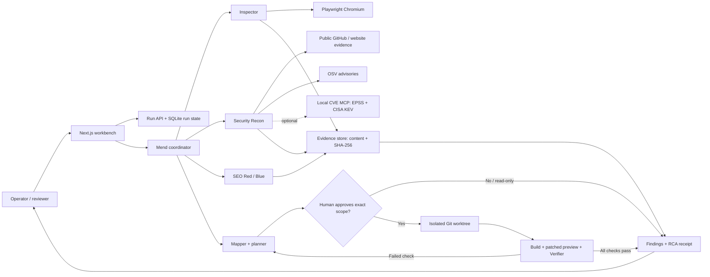
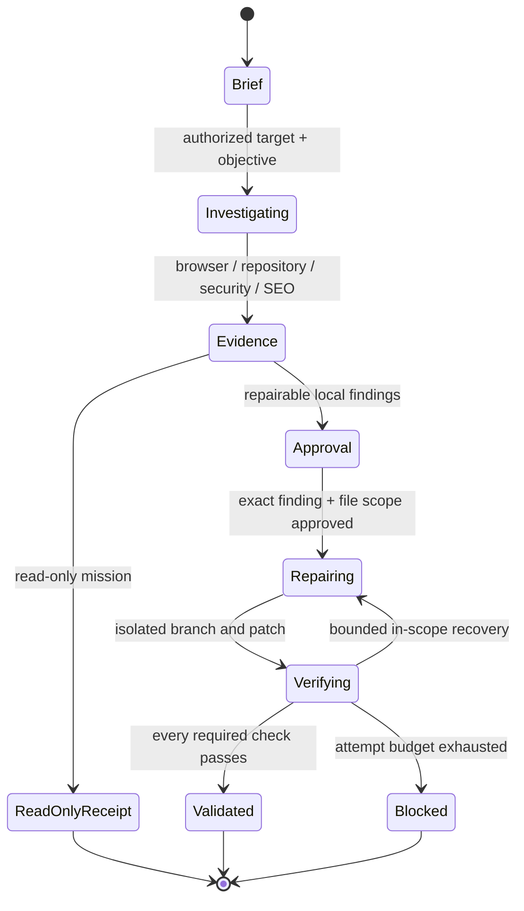

# TrustPatch

**Evidence before confidence. AI proposes. Tools verify. Humans authorize.**

TrustPatch is a supervised-autonomous repair agent for websites. It inspects real pages and repositories, preserves reproducible evidence, proposes narrowly scoped repairs, and verifies the patched application before calling anything fixed.

Built by **Shaidan Shaari ([NusaByte](https://nusabyte.my))** for the **Meta Global AI Developer Hackathon** — **Startup track · Build for Your World**.

| | |
|---|---|
| **Live application** | [trustpatch.72.62.254.65.sslip.io](https://trustpatch.72.62.254.65.sslip.io) |
| **Repository** | [github.com/nusabyte-my/TrustPatch](https://github.com/nusabyte-my/TrustPatch) |
| **Primary agent** | Mend, coordinating Inspector, Mapper, Recon, SEO, Repair, and Verifier |
| **Current repair target** | Explicitly authorized local Next.js fixture |
| **External websites / repositories** | Read-only inspection |
| **Merge / deploy autonomy** | None |

## Why TrustPatch

A typical audit says **what might be wrong**. TrustPatch answers:

> What is broken, what proves it, which files are responsible, what is the smallest safe repair, and what proves the repair worked?

It closes the gap between an alert and a reviewed repair without giving an agent unrestricted shell, merge, or deployment authority.

### Demonstrated capabilities

- Real browser inspection of rendered pages, raw HTML, response headers, console errors, failed requests, and public artifacts.
- Technical SEO and AI-answer-readiness analysis without ranking or citation guarantees.
- Website and GitHub security reconnaissance with redacted secret indicators; secrets are never used or validated.
- Dependency vulnerability intelligence using OSV, optional CVE MCP, EPSS, and CISA KEV evidence.
- Exact file-scoped human approval before repository mutation.
- Isolated Git worktree patches, independent builds, browser verification, and bounded recovery after a failed first attempt.
- Per-finding RCA PDFs, evidence hashes, email previews/delivery, and a durable Proof Receipt.

## System architecture



### Runtime layout

| Component | Responsibility |
|---|---|
| `apps/web` | Next.js workbench, mission setup, agent console, evidence/RCA APIs |
| `apps/worker` | Run orchestration, approval-gated repair, retry and verification |
| `packages/contracts` | Zod run, scope, finding, approval, event, and Proof Receipt contracts |
| `packages/core` | Browser inspection, repository/security analysis, evidence, persistence, repair and verification |
| `fixtures/broken-next-site` | Deliberately defective, explicitly authorized Next.js repair target |
| `.data/` | Local SQLite database and fixture baseline; never committed |
| `artifacts/` | Immutable evidence content addressed by SHA-256; never committed |

### Technology

**Node.js 22 · TypeScript · pnpm workspaces · Next.js App Router · React · SQLite/Drizzle · Playwright · Zod · Git worktrees · pdf-lib**

Optional integrations:

- **Muse / LLM planning** with `AGENT_MODE=meta` for the official Meta Responses API or `AGENT_MODE=llm` with an explicitly configured OpenAI-compatible provider. Structured tool output is schema-validated; receipts identify `meta-model`, `llm-model`, or `fixture-planner` separately.
- **JEBAT MCP ecosystem** through a server-side allowlist of 14 research, SEO, advisor, and passive security tools. SEO/advisor evidence is stored with its limitations. No shell, filesystem, credential, deployment, or external mutation tools are exposed to browser users.
- **Provider health** at `/api/integrations` and in the landing-page status panel. Configured, available, and blocked are distinct states; credentials are never returned.
- **CVE MCP** for dependency scan, EPSS, and CISA KEV enrichment. OSV works independently.
- **GitHub REST API** for authorized public-repository inspection and optional draft-PR publication.
- **REA MCP** for passive browser/static-bundle evidence when configured.
- **Resend** for actual RCA email delivery; otherwise the app produces a local `.eml` preview and sends nothing.

## Agent workflow



1. **Brief** — the operator supplies a target, objective, path/check scope, and authorization.
2. **Investigate** — specialists collect actual rendered/source/response evidence. No code is changed.
3. **Review** — findings link to evidence and responsible files. Read-only missions end here.
4. **Approve** — the operator reviews and approves the exact finding IDs and permitted files.
5. **Repair** — only the approved files are modified in an isolated Git worktree.
6. **Verify** — a separate patched build and browser preview test actual behavior.
7. **Recover or stop** — failed checks feed a bounded in-scope retry; failure is never relabeled success.
8. **Receipt** — the result retains checks, branch, changed files, evidence hashes, and `deployed: false`.

## How to use

### Quick start

Prerequisites: Node.js 22, pnpm 10, Git, and Playwright Chromium.

```bash
git clone https://github.com/nusabyte-my/TrustPatch.git
cd TrustPatch
corepack enable
pnpm install
pnpm exec playwright install chromium
cp .env.example .env       # Windows: copy .env.example .env
pnpm db:migrate
pnpm dev
```

Open **[http://localhost:7258](http://localhost:7258)**. The authorized broken fixture runs at `http://127.0.0.1:3100`; the worker runs alongside the web application.

### Run a read-only website inspection

1. Choose a mission such as **Investigate a technical problem** or **Run a security and API-leak audit**.
2. Enter a website you own or are explicitly permitted to inspect.
3. Confirm authorization, select pages/checks, and keep **Read-only inspection** enabled.
4. Start the mission and select **Review findings** when it completes.
5. Open the stored evidence or download a per-finding RCA PDF.

External targets are read-only. Browser inspection is passive; it does not prove the absence of vulnerabilities.

### Audit a GitHub repository

1. Choose **Audit a GitHub repository**.
2. Enter `https://github.com/owner/repository` and confirm authorization.
3. Include repository secret/configuration and dependency-vulnerability checks.
4. Review advisory IDs, CVE aliases, fixed releases, EPSS, KEV status, and evidence links.

Public default branches are supported without a token. Configure a restricted server-side `GITHUB_TOKEN` only for explicitly authorized private access. The scan covers up to 80 eligible text files, 500 KB each. Exact and lockfile-resolved versions are analyzed; unresolved ranges are never treated as installed versions.

### Complete the repair demonstration

1. Select a repair mission with `http://127.0.0.1:3100` as the target.
2. Disable read-only mode for the authorized local fixture.
3. Inspect the findings and approve only the proposed file scope.
4. Watch the first verification fail on the inherited layout `noindex`.
5. The worker diagnoses that evidence, applies a second in-scope repair, and validates indexing, canonical, and `nosniff` behavior.
6. Open the Proof Receipt. Nothing is merged or deployed.

`FIXTURE_RECOVERY=false` makes the fixture deterministic in one repair attempt. The default two-attempt path exists to demonstrate evidence-driven recovery.

## Vulnerability intelligence

Supported manifests: `package.json`, `package-lock.json`, `requirements.txt`, `pyproject.toml`, `poetry.lock`, and `uv.lock` for exact/locked npm and PyPI dependencies.

OSV batch matches are hydrated into complete advisories. When `CVE_MCP_URL` is configured, TrustPatch also calls the local CVE MCP server for dependency scanning, EPSS, and CISA KEV checks. Each result distinguishes **dependency-version exposure** from **application exploitability**.

### Optional CVE MCP setup

```bash
git clone --depth 1 https://github.com/mukul975/cve-mcp-server.git .data/tools/cve-mcp-server
uv venv .data/tools/cve-mcp-server/.venv --python 3.12
uv pip install --python .data/tools/cve-mcp-server/.venv/Scripts/python.exe .data/tools/cve-mcp-server 'mcp[cli]>=1.7,<2'
```

The upstream server currently requires MCP SDK 1.x. Start it on loopback:

```bash
# From .data/tools/cve-mcp-server
MCP_TRANSPORT=http HOST=127.0.0.1 PORT=8000 ./.venv/Scripts/python.exe -m cve_mcp.server
```

Set `CVE_MCP_URL=http://127.0.0.1:8000/mcp` in `.env`. On POSIX, use `.venv/bin/python`. Keep provider credentials only in its server-side environment.

### JEBAT MCP setup

Run JEBAT on loopback with a strict tool allowlist. TrustPatch independently enforces the same allowlist before every tool call.

```bash
# From the JEBAT workspace
JEBAT_MCP_TOOLS_ALLOW='advisor_classify,advisor_decide,advisor_gate,advisor_score,advisor_verify,search_web,web_extract,seo_audit,seo_keyword_extract,seo_content_brief,seo_meta_generate,pentest_header_check,pentest_ssl_check,pentest_cve_search' \
  python -m jebat_cli_new mcp serve --transport http --host 127.0.0.1 --port 18789
```

Set `JEBAT_MCP_URL=http://127.0.0.1:18789/message` and optionally `JEBAT_MCP_API_KEY`. For production, run the provider beside the worker with a unique API key. Only public targets receive JEBAT passive header checks. REA remains optional and requires both `REA_MCP_URL` and `REA_CDP_URL`; its absence is reported rather than simulated.

## Configuration

All configuration is server-side. Never put secrets in `NEXT_PUBLIC_*` variables or commit `.env`.

| Variable | Purpose |
|---|---|
| `AGENT_MODE` | `fixture` for deterministic offline planning, `meta` for official Muse, or `llm` for a configured OpenAI-compatible provider |
| `MODEL_API_KEY` | Server-side model credential for `meta` or `llm` mode |
| `MODEL_API_URL`, `MODEL_ID` | Provider endpoint/model overrides |
| `MODEL_API_PROTOCOL` | `responses` for official Muse; `chat_completions` for compatible providers |
| `JEBAT_MCP_URL`, `JEBAT_MCP_API_KEY` | Scoped JEBAT MCP endpoint and optional bearer credential |
| `TRUSTPATCH_DATABASE`, `TRUSTPATCH_ARTIFACTS` | Persistent SQLite and evidence paths |
| `GITHUB_TOKEN` | Optional authorized repository access/draft-PR credential |
| `CVE_MCP_URL` | Optional local CVE intelligence provider |
| `REA_MCP_URL`, `REA_CDP_URL` | Optional passive REA browser enrichment |
| `RESEND_API_KEY`, `RESEND_FROM_EMAIL` | Optional real email delivery |
| `FIXTURE_RECOVERY` | Enables the two-attempt recovery demonstration |

**Official Muse requires a valid Meta Model API credential.** The available third-party Muse-compatible credential returned HTTP 402, and other configured gateways did not offer Muse. The official adapter is therefore not claimed as verified. A real alternate-provider structured repair plan was exercised successfully; its subsequent full workflow paused on gateway HTTP 429/502 errors and is not claimed as a validated repair. Offline runs are labeled `fixture-planner`; alternate-provider receipts are labeled `llm-model`, never `meta-model`. GitHub draft-PR publication likewise requires an authorized repository and token.

## Verification

```bash
pnpm typecheck
pnpm test
pnpm test:adversarial
pnpm build
```

`pnpm test:e2e` exercises the complete two-attempt repair using isolated storage and real Next.js builds. It requires the fixture on port 3100 and must never target production.

## Deployment

The current architecture needs **one persistent Node.js server**, not a static or multi-replica serverless deployment: SQLite, evidence files, Playwright, Git worktrees, and the worker share local state.

```bash
pnpm install --frozen-lockfile
pnpm exec playwright install --with-deps chromium
pnpm db:migrate
pnpm build
pnpm start:web       # 127.0.0.1:7258
pnpm start:worker    # separate persistent process
```

Keep `.data/`, `artifacts/`, and unfinished worktree state persistent. Terminate TLS at Nginx/Caddy and proxy only the web port. Do not expose fixture or patched-preview ports.

The hackathon demo is deployed at **https://trustpatch.72.62.254.65.sslip.io** on an existing Hostinger Ubuntu VPS. Dedicated `trustpatch-web` and `trustpatch-worker` systemd services run as an unprivileged `trustpatch` account; Nginx terminates a Let's Encrypt HTTPS certificate and proxies to `127.0.0.1:7258`. The custom `trustpatch.nusabyte.my` hostname requires Cloudflare DNS edit access; the connected credential was read-only, so the working `sslip.io` hostname is published instead. The demo has no public authentication or tenant isolation; treat it as a demonstration, not a multi-tenant production service.

See [DEPLOYMENT.md](DEPLOYMENT.md) for service management, reverse proxy, backups, and production hardening.

## Security and scope boundaries

- No arbitrary repair, merge, deployment, credential validation, or exploitation.
- Remote targets are read-only; only the explicitly authorized fixture can be patched.
- External URLs reject credentials and private/metadata/link-local destinations at the application layer. Chromium performs its own resolution, so this is not a network-egress sandbox.
- Secret-shaped values are redacted and never used. Public advisories and third-party content are untrusted data, not instructions.
- Empty repair scopes are rejected; approval is consumed once; a changed scope requires renewed approval.
- Public multi-user use still requires authentication, tenant isolation, verified domain ownership, worker isolation, a durable queue, and retention controls.

## Documentation

- [Detailed user guide](USING_TRUSTPATCH.md)
- [Deployment guide](DEPLOYMENT.md)
- [Hackathon product and technical plan](TRUSTPATCH_HACKATHON_PLAN.md)

## License

MIT — see [LICENSE](LICENSE).
