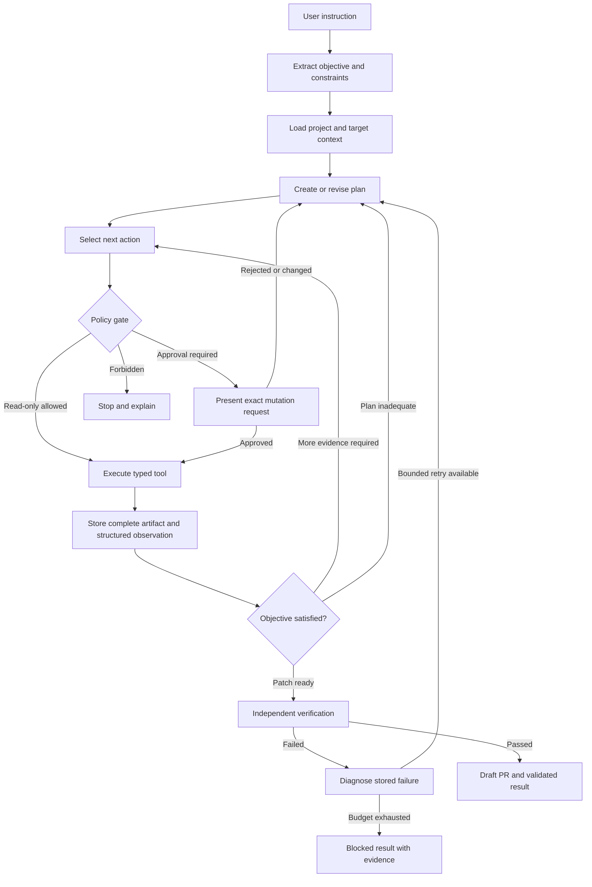
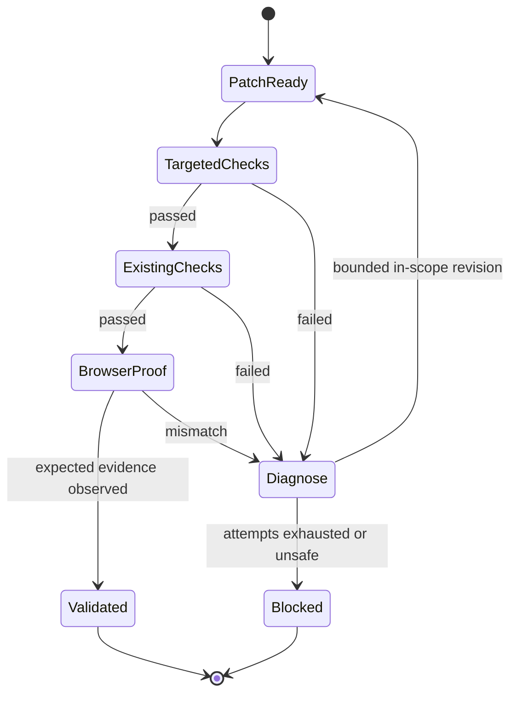
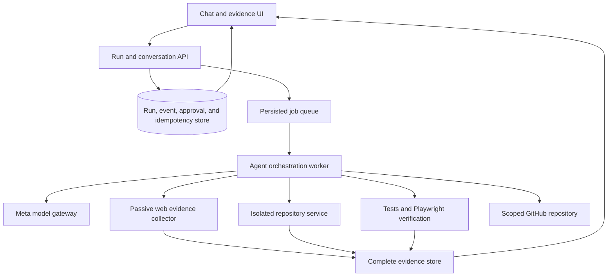

# TrustPatch — Meta Global AI Developer Hackathon

**Document status:** Canonical product plan plus local implementation evidence  
**Brand:** TrustPatch  
**Directive:** Build a chat-first, supervised-autonomous repair agent for verified-owned Next.js websites  
**Build rule:** One evidence-backed repair loop before expanding scope  
**Track:** Startup  
**Theme:** Build for Your World  
**Submission deadline:** November 4, 2026 at 9:00 PM ET  
**Primary interface:** Conversational AI agent  
**Initial platform:** Verified-owned Next.js websites and repositories  
**Core outcome:** A tested, evidence-backed repair—not another audit report

---

## 0. Local Implementation Evidence — October 27, 2026

The local MVP is implemented in this workspace. The workbench runs on **http://localhost:7258**; the authorized fixture runs on port 3100.

Verified in the actual application:

- Read-only investigation returned four observations and did not request mutation approval.
- Repair investigation produced three findings with complete evidence and an exact file-scoped approval.
- The user-approved worker created an isolated Git worktree and real patch.
- Attempt 1 failed verification with `Indexing directive: noindex, nofollow`.
- Attempt 2 repaired the inherited layout within the approved scope.
- Final run `run_3c23166b-03d8-48aa-b028-6eb2e64b7d93` reached `validated` with all three checks passing: indexing directive, canonical target, and MIME-sniffing protection.
- The actual UI completed the same flow on port 7258, with `Validated locally` and three passing checks.
- Browser check at 1440px and emulated 375px reported no horizontal document overflow.
- Live Mend activity stream verified in the browser: queued run, per-URL inspections, vulnerability alerts, approval scope, first failed verification, second repair, and final validation.
- Regression tests: 5 passing. Workspace TypeScript checks and production builds pass for contracts, core, fixture, and web.
- Evidence writes are idempotent for identical bytes; approvals are consumed atomically once; empty approvals are rejected; CRLF anchors are supported.

Not yet exercised:

- A real Meta Model API call. The Responses API adapter is implemented, but no API credential was available in the current environment. Successful runs are explicitly labeled `fixture-planner`, never represented as Meta-model results.
- Real GitHub draft-PR creation. The direct REST integration is implemented but requires a user-supplied disposable repository and token.
- General third-party repository support, remote ownership verification, production deployment, and arbitrary target scanning.

Implementation notes are in `README.md`. `test:e2e` now packages the real two-attempt workflow with a five-minute timeout and isolated test database; it requires the fixture server on port 3100 and passed in 27 seconds. Reliability follow-up added root `.env` loading, verification/provider recovery polling, worktree reuse, empty-plan rejection, and idempotent PR commit handling.

---

## 1. Executive Summary

TrustPatch is a conversational, supervised-autonomous repair agent for production websites. It connects deterministic security and technical SEO evidence to the responsible source code, plans the smallest safe repair, creates a human-approved pull request, and verifies the result using existing checks and browser assertions.

Existing tools primarily answer:

> What might be wrong?

TrustPatch answers:

> What is broken, what evidence supports the finding, where is the responsible code, what is the smallest safe repair, and what proves the repair worked?

The hackathon MVP deliberately supports three repair workflows:

1. Accidental `noindex` on an indexable page.
2. Canonical URL pointing to a staging or otherwise unapproved host.
3. Missing project-approved security header.

The agent operates through natural-language instructions and a Hermes-style iterative tool loop. It independently investigates, plans, patches, tests, diagnoses failures, and replans. Humans approve repository mutations and retain exclusive control over merge and deployment.

### Brand and directive

**Brand:** TrustPatch  
**Tagline:** Review the evidence. Approve the patch. Verify the repair.  
**Alternative if clearance fails:** PatchProof  
**Product directive:** Build a chat-first agent that repairs verified technical SEO and security defects in owned Next.js websites, then proves each fix with tests and browser evidence.  
**Operating contract:** AI investigates and repairs. Deterministic tools verify. Humans control authority.

### Elevator pitch

> TrustPatch is an AI repair agent for Next.js websites. It turns confirmed security and technical SEO findings into small, human-approved pull requests, then proves the repair through deterministic tests and browser verification—without merging or deploying autonomously.

---

## 2. Hackathon Alignment

The official hackathon describes two participant tracks:

- **Indie developer:** creativity, technical ambition, and whether the project works.
- **Startup:** technical execution and whether the product holds up in production.

TrustPatch targets the **Startup** track and the **Build for Your World** theme.

| Official criterion | TrustPatch response |
|---|---|
| Solve a firsthand problem | Derived from real web-agency, production deployment, technical SEO, and defensive-security work |
| Technical execution | Cross-layer evidence collection, repository reasoning, typed agent orchestration, patch generation, isolated execution, and browser verification |
| Production credibility | Ownership verification, scoped authorization, idempotent tools, human approval, audit events, reversible Git changes, and explicit deployment boundaries |
| Meaningful use of Meta models | Evidence interpretation, source localization, repair planning, patch generation, and failure diagnosis |
| Clear demonstration | A broken Next.js site becomes a verified repair through one conversational workflow |

**Official event source:** [Meta Global AI Developer Hackathon](https://dev.meta.ai/events/global-hackathon)

---

## 3. Naming Options

These are naming candidates only. Trademark, company-name, package-name, and domain availability have **not** been checked.

| Name | Rationale | Tradeoff |
|---|---|---|
| **TrustPatch** | Combines controlled autonomy with the concrete repair artifact | Broad enough to extend beyond websites; likely a more crowded naming space |
| **PatchProof** | Emphasizes the differentiator: every patch carries verification evidence | Slightly less explicit about website scope |
| **FixLedger** | Suggests an auditable record of findings, approvals, diffs, and verification | Sounds more like compliance/reporting than active repair |
| **SiteMend** | Short, approachable, and directly related to website repair | Does not communicate evidence or AI-agent behavior |
| **RepairPilot** | Communicates guided execution with a human in control | “Pilot” is common across AI products and less distinctive |

### Recommendation

Retain **TrustPatch** as the hackathon working title because it already represents the accepted product direction. Use **PatchProof** as the strongest alternative if a name conflict appears. Conduct name and domain clearance before public launch; do not claim availability in submission materials.

---

## 4. Problem and Research Basis

### 4.1 Operational problem

Agencies and lean product teams repeatedly follow this workflow:

1. A scanner or crawler produces findings.
2. A specialist determines which findings are real and relevant.
3. A developer locates the responsible configuration or component.
4. Someone translates the recommendation into framework-specific code.
5. The repair is tested inconsistently.
6. A later deployment reintroduces the same defect.

The costly step is not generating another list. It is **evidence interpretation, source localization, safe implementation, and verification**.

### 4.2 Research signals

- The [SANS 2025 Detection and Response Report](https://www.sans.org/research/detection-response-report) found that 73% of respondents named false positives their leading detection challenge; 59% cited a lack of skilled personnel as a top challenge. This supports a trust and remediation focus rather than more alert volume.
- [Google’s AI-features guidance](https://developers.google.com/search/docs/appearance/ai-features) states that foundational SEO practices apply and no special technical optimization is required for AI Overviews or AI Mode. TrustPatch therefore avoids “guaranteed GEO ranking” claims.
- [Google’s site-move guidance](https://developers.google.com/search/docs/crawling-indexing/site-move-with-url-changes) documents the need to inspect redirects, canonicals, and robots directives during website changes.
- [Ahrefs’ own-brand study](https://ahrefs.com/blog/ai-citations-vs-impressions-study/) found that mentions frequently lacked links. This supports future AI-answer source monitoring, not a claim that TrustPatch can control citations.
- An [ISB research summary](https://www.isb.edu/faculty-and-research/isb-institute-of-data-science/research/ai-summaries-in-search-and-their-impact-on-publisher-traffic) reports reduced organic clicks in an AI-summary experiment. This is market context, not evidence that a technical repair guarantees traffic recovery.

### 4.3 Research limitation

The pain hypothesis is supported by industry research and firsthand operating experience. Willingness to pay remains unvalidated. Before positioning as a commercial product, interview 5–8 agency owners or developers and test whether verified repair PRs solve a current, budgeted problem.

### 4.4 Advisor record

A schema-correct advisor probe weakly preferred ProofGuard at 3.23% confidence; subsequent control recommendations also had very low confidence. These results were treated as inconclusive and did not override the user-accepted TrustPatch direction or the safety analysis.

---

## 5. Target Users and Jobs to Be Done

### Primary user: small web agencies

Teams maintaining multiple client Next.js websites where security and technical SEO repairs compete with billable delivery work.

**Job to be done:**

> When a client website has a confirmed technical defect, produce the smallest safe code repair and proof that it works, so a developer can review and merge it without manually tracing every layer.

### Secondary user: lean SaaS product teams

Small engineering teams without dedicated technical SEO and application-security specialists.

**Job to be done:**

> Before or after a release, identify and repair narrowly defined production website defects without requiring a separate specialist for each domain.

### Initial non-targets

- Enterprise SOC teams.
- Arbitrary websites without verified ownership.
- Authenticated vulnerability exploitation.
- Users seeking keyword research, mass content generation, or ranking guarantees.
- WordPress, Shopify, Webflow, Laravel, and other non-Next.js stacks during the MVP.

---

## 6. Product Principles

1. **Repair over reporting.** Success is a verified behavioral change, not a higher audit score.
2. **Evidence before inference.** Findings originate from deterministic observations.
3. **AI proposes; tools verify; humans authorize.** Each layer has a distinct responsibility.
4. **Smallest safe repair.** Do not rewrite unrelated code or introduce a second project convention.
5. **Autonomy with boundaries.** The agent acts independently inside explicit permissions.
6. **No false completion.** A diff is not a fix; validation requires observed results.
7. **Production changes remain human-controlled.** No autonomous merge or deployment.
8. **No ranking promises.** Validate technical outcomes, not future search performance.

---

## 7. Conversational Product Experience

### 7.1 Primary instruction

> Check our staging site. Fix anything that would prevent production indexing, but do not change security headers.

### 7.2 Expected agent behavior

1. Extract the objective and constraints.
2. Load connected target and repository context.
3. Inspect approved pages and source autonomously.
4. Maintain a visible, revisable plan.
5. Report evidence-backed findings.
6. Request approval for the exact mutation scope.
7. Create an isolated branch and apply a focused patch.
8. Run targeted and existing checks.
9. Diagnose failures and revise within the approved scope.
10. Stop before draft-PR creation if requested.
11. Resume from the same checkpoint after a follow-up instruction.

### 7.3 Supported chat instructions

| User instruction | Required interpretation |
|---|---|
| “Explain this finding; do not patch.” | Read-only investigation and explanation |
| “Fix canonical issues but leave headers unchanged.” | Scope limited to canonical workflow |
| “Ignore `/blog`.” | Add path exclusion without dropping other constraints |
| “Use the existing metadata helper.” | Add implementation convention constraint |
| “Stop after showing the diff.” | Branch/patch allowed; PR creation not allowed |
| “Resume and open the draft PR.” | Resume checkpoint; request PR permission if not already granted |
| “Why did verification fail?” | Explain stored failure evidence without mutating |
| “Scan this other domain too.” | Treat as target expansion requiring separate ownership verification |

### 7.4 Contract refinement rules

- Later messages may narrow scope directly.
- Later messages may not silently erase prior restrictions.
- Expanding hosts, paths, mutation permissions, or repair categories requires explicit confirmation.
- The model cannot modify its own authorization policy.
- Missing information is requested only when tools and connected context cannot supply it.

---

## 8. MVP Scope

### 8.1 Supported repair workflows

| Workflow | Deterministic evidence | Agent responsibility | Required verification |
|---|---|---|---|
| Accidental `noindex` | Raw HTML and rendered DOM expose the directive | Determine whether it conflicts with intent; locate responsible metadata source | Patched local page renders the intended directive |
| Staging canonical | Canonical host differs from approved production host | Trace canonical generation and environment assumptions | Rendered canonical resolves to the approved URL |
| Missing approved security header | Response lacks a header required by project policy | Locate framework/server configuration and propose compatible change | Header is present and application smoke checks pass |

### 8.2 Security-header constraint

Do not generate a strict Content-Security-Policy and automatically declare it safe. Start with a project-approved policy or report-only policy. Browser smoke checks must detect broken application behavior.

### 8.3 Optional workflow

Structured-data/visible-content mismatch is considered only after all three primary workflows pass end-to-end. It is not required for MVP completion.

### 8.4 Explicit non-goals

- No active exploitation or authenticated vulnerability scanning.
- No arbitrary internet target scanning.
- No automatic merge or deployment.
- No unrestricted model-generated shell commands.
- No complete SEO suite, keyword research, rank tracking, or content factory.
- No support for every framework or CMS.
- No claim of guaranteed rankings, citations, traffic, or vulnerability-free status.
- No GitHub App installation flow in the hackathon demo.

---

## 9. Agent Architecture

### 9.1 Execution model

The conversational agent is **Mend**. Mend is the single user-facing coordinator inside TrustPatch, supervising four bounded specialists through one persisted run contract:

| Agent | Responsibility | May mutate? |
|---|---|---|
| **Mend / Coordinator** | Interprets chat, maintains constraints and plan, dispatches specialists, handles approval and resume | Only through policy-gated repair tools |
| **Inspector** | Captures raw/rendered website evidence and produces deterministic findings | No |
| **Mapper** | Reads repository context and maps findings to candidate source files | No |
| **Repair** | Produces and applies the smallest scoped patch after approval | Approved worktree only |
| **Verifier** | Independently runs checks, reads complete evidence, and gates validation | No |

Inspector and Mapper may execute concurrently after intake: Inspector owns website observations; Mapper owns repository structure and conventions. They exchange only typed evidence references, never free-form authority. Mend joins their outputs before constructing the mutation preview. Repair starts only after approval. Verifier is a separate role with no ability to mark its own patch valid.

This is supervised multi-agent orchestration, not an open-ended agent swarm. Specialists share the same run state and Meta model gateway, but have separate instructions, tool allowlists, outputs, and failure states. A local deterministic planner may be used for the labeled fixture; the UI must identify `fixture-planner` versus `meta-model` provenance and never present one as the other.

### 9.2 Hermes-style loop

**Perceive → Plan → Act → Observe → Reflect → Verify → Report**

The model chooses actions within this loop. The orchestrator controls permissions, tool execution, evidence integrity, budgets, retries, and completion requirements.



### 9.3 Autonomy boundary

**Autonomous without per-call approval:**

- Read connected project context.
- Crawl authorized pages within configured limits.
- Search and read repository source.
- Build findings and repair plans.
- Run read-only diagnostics.
- Explain evidence in chat.

**Approval required:**

- Create a work branch.
- Apply a patch or add a targeted test.
- Open a draft pull request.
- Materially expand the approved mutation scope.

**Always forbidden to the agent:**

- Merge a pull request.
- Deploy to production.
- Change production secrets or environment credentials.
- Perform active security testing.
- Revert or overwrite the user’s working tree.
- Disable or weaken a failing check merely to obtain a green result.

---

## 10. Run Contract and State Model

### 10.1 Example run contract

```json
{
  "objective": "Repair production-indexing defects",
  "target": {
    "site_id": "site_123",
    "repository_id": "repo_456",
    "base_branch": "main",
    "environment": "staging"
  },
  "scope": {
    "include_checks": ["noindex", "canonical"],
    "exclude_checks": ["security_headers"],
    "include_paths": ["/", "/services"],
    "exclude_paths": ["/blog"]
  },
  "autonomy": {
    "read_only": true,
    "create_branch": "approval_required",
    "write_patch": "approval_required",
    "open_draft_pr": "approval_required",
    "merge": "forbidden",
    "deploy": "forbidden"
  },
  "constraints": {
    "max_pages": 50,
    "max_patch_attempts": 3,
    "preserve_existing_tests": true
  }
}
```

### 10.2 Run states

```ts
type RunStatus =
  | "idle"
  | "planning"
  | "awaiting_tool"
  | "executing_tool"
  | "awaiting_approval"
  | "awaiting_user"
  | "verifying"
  | "validated"
  | "blocked"
  | "paused_provider_error"
  | "cancelled";
```

### 10.3 Finding states

- `observed`: directly measured fact.
- `suspected`: plausible interpretation requiring confirmation.
- `verified`: confirmed by a safe deterministic check.
- `repaired`: patch applied in an isolated worktree.
- `validated`: required post-patch checks passed.

`validated` never means deployed.

### 10.4 Item completion states

Every requested item must finish as:

- `validated`
- `blocked`
- `skipped_by_user`
- `out_of_scope`
- `not_found`

The agent may not report overall success while a required item remains unresolved.

---

## 11. Typed Tool Interface

The MVP exposes typed tools with structured arguments and outputs. It does not expose a generic `shell(command)` tool to the model.

### 11.1 Read-only tools

| Tool | Purpose |
|---|---|
| `get_project_context` | Load target, framework, commands, and policy |
| `list_repository_files` | Inspect relevant repository structure |
| `read_source` | Read bounded, redacted source excerpts |
| `search_source` | Locate metadata and configuration symbols |
| `fetch_page_evidence` | Capture status, headers, raw HTML, and rendered DOM |
| `crawl_allowed_site` | Crawl bounded paths on an authorized host |
| `inspect_metadata` | Extract robots and canonical evidence |
| `get_project_scripts` | Discover existing test/build commands |
| `get_run_status` | Recover progress after interruption |
| `get_evidence_metadata` | Inspect complete artifact metadata |
| `get_evidence_excerpt` | Retrieve a bounded, explicitly ranged artifact section |
| `get_diff_section` | Read a selected file or hunk from a stored diff |
| `get_test_log_section` | Read a selected range from a complete test log |

### 11.2 Mutation tools

| Tool | Approval | Purpose |
|---|---:|---|
| `create_work_branch` | Required | Create isolated branch from approved base |
| `apply_patch` | Required | Apply scoped diff inside the run worktree |
| `write_verification_test` | Required | Add targeted behavioral coverage |
| `create_draft_pr` | Required | Publish approved diff and evidence |

### 11.3 Verification tools

| Tool | Purpose |
|---|---|
| `install_dependencies` | Reproduce the project environment in isolation |
| `run_project_check` | Execute a reviewed, allowlisted existing script |
| `run_targeted_test` | Verify repaired behavior |
| `start_local_preview` | Launch patched application in an isolated environment |
| `assert_browser_evidence` | Check post-patch DOM, canonical, or response headers |
| `compare_before_after` | Produce evidence deltas from complete artifacts |

All tools require `run_id`, an idempotency key, and schema-valid arguments. Tool outputs are typed results or typed errors, never ambiguous prose.

---

## 12. Model Protocol and Failure Handling

### 12.1 Structured model responses

Do not parse tool calls from Markdown fences or free-form prose. The model gateway returns schema-validated responses with one of these kinds:

- `plan_revision`
- `tool_request`
- `approval_request`
- `user_question`
- `completion_claim`

Example:

```json
{
  "kind": "tool_request",
  "request_id": "req_01J...",
  "run_id": "run_01J...",
  "step_id": "step_04",
  "tool": "inspect_metadata",
  "arguments": {
    "target_id": "target_123",
    "paths": ["/", "/services"]
  },
  "reason": "Compare indexing directives across approved pages."
}
```

The exact Meta model and provider request format will be selected after verifying available structured-output/tool-calling support. If native tool calling is unavailable, use constrained JSON with local schema validation—not regex parsing of fenced text.

### 12.2 Invalid model output

Invalid JSON, unknown tools, invalid arguments, and unexpected response kinds produce `model_protocol_error`.

Rules:

1. Execute no action from an invalid response.
2. Never convert malformed output into a final answer.
3. Retry only the failed model invocation with validation feedback.
4. Stop after a bounded retry count.
5. Preserve the last valid checkpoint for resume.

### 12.3 Provider failures

Provider failures are typed workflow events, not assistant text.

```json
{
  "type": "provider.failed",
  "run_id": "run_01J...",
  "step_id": "step_19",
  "operation": "repair_plan",
  "error_class": "upstream_unavailable",
  "retryable": true,
  "attempt": 2,
  "next_action": "resume_same_step"
}
```

Required behavior:

- Do not advance the plan.
- Do not execute a partial call.
- Retry transient failures with bounded backoff.
- Reuse the same idempotency key on retry.
- Pause at the same step after retries are exhausted.
- Resume without repeating completed mutations.

---

## 13. Evidence Architecture

### 13.1 Complete artifacts outside the transcript

Full HTML, DOM snapshots, diffs, headers, and logs live in durable object storage or content-addressed local artifact storage. The model transcript stores references and relevant structured excerpts, not truncated substitutes for the original artifact.

```json
{
  "evidence_id": "ev_01J...",
  "run_id": "run_01J...",
  "kind": "rendered_dom",
  "url": "https://staging.example.com/services",
  "sha256": "...",
  "storage_uri": "evidence/run_01J/ev_01J....json",
  "size_bytes": 184220,
  "created_at": "..."
}
```

### 13.2 Model evidence window

```json
{
  "evidence_id": "ev_01J...",
  "observation": {
    "status": 200,
    "robots": ["noindex", "nofollow"],
    "canonical": "https://staging.example.com/services"
  },
  "excerpt": {
    "source": "head",
    "start_line": 14,
    "end_line": 29,
    "complete": false
  }
}
```

Every excerpt includes explicit range and completeness metadata. The model may request additional ranges through typed tools.

### 13.3 Integrity rule

Truncated model context must never truncate the stored artifact, verification input, audit record, or attached PR evidence. Independent verifiers read complete artifacts and compare recorded digests.

---

## 14. Approval and Mutation Protocol

A mutation preview contains:

- Findings being repaired.
- Expected files or path scope.
- Branch name and base commit.
- Whether a targeted test may be added.
- Whether a draft PR may be opened.
- Exact verification commands the agent intends to run.

Approval is bound to this scope. A materially different patch requires renewed approval.

### In-scope revision test

After the initial mutation approval, the agent may revise a failed patch autonomously only when **all** of these conditions hold:

1. The revision repairs only findings listed in the approved finding set.
2. Every changed file is inside the approved file allowlist and allowed repository paths.
3. It introduces no new repair category, dependency, network destination, executable command, or other capability.
4. It stays within the approved verification commands and remaining patch-attempt budget.
5. It preserves every user exclusion and does not merge, deploy, or alter production configuration.

The orchestrator evaluates these conditions against the actual diff and tool arguments before each subsequent mutation. If any condition fails, the run enters `awaiting_approval` with the expanded diff scope and reason. Model prose cannot authorize an expansion.

### Idempotency requirements

- A branch-creation key cannot create two branches.
- A patch-attempt key cannot apply the same patch twice.
- A PR-creation key cannot open duplicate pull requests.
- Retried model calls do not repeat successful tools.
- Every external mutation records its request key and resulting remote identifier.

---

## 15. Verification and Self-Repair

A patch is not complete because code was written.



### Failure policy

| Failure | Agent behavior |
|---|---|
| Patch does not apply | Re-read current file and generate a new minimal diff |
| Patch causes typecheck/test failure | Diagnose and revise within approved scope |
| Pre-existing failure | Record baseline evidence; do not silently repair unrelated code |
| Application does not start | Stop verification and return runtime evidence |
| Browser assertion fails | Compare expected and observed evidence; replan |
| Invalid model response | Retry model invocation without executing tools |
| Provider unavailable | Preserve run and allow resume |
| Three patch attempts fail | Return blocked with complete evidence history |

The agent must not revert the user’s working tree, weaken assertions, hide failures, or deploy a previous release.

---

## 16. Security, Privacy, and Prompt Injection

### 16.1 Authorization

- Verify domain ownership before remote inspection.
- Restrict repository access to explicitly connected repositories.
- Enforce allowed hosts and paths outside the model.
- Use passive checks only in the MVP.
- Require separate authorization for every new target host.

For the local demo fixture, ownership and authorization may be established through local project configuration. The UI must identify this as a local verified fixture, not imply remote domain verification occurred.

### 16.2 Untrusted content

Website and repository content is data, never agent instruction. The agent must ignore:

- HTML comments requesting commands or secrets.
- README instructions requesting expanded permissions.
- Pages instructing the agent to scan another host.
- Source comments telling it to disable verification.
- Tool output asking it to override policy.

### 16.3 Secrets and data handling

- Store credentials only in server-side environment configuration or a secrets manager.
- Never write credentials into source, browser storage, evidence, PRs, logs, or documentation.
- Redact secret-like values before model calls.
- Minimize repository and page content sent to the model.
- Define evidence retention and deletion behavior before production use.
- Do not expose the GitHub token to the browser or agent transcript.

### 16.4 Execution isolation

- Use a fresh Git worktree or isolated clone per run.
- Pin the approved base commit.
- Run project scripts only after command review and allowlisting.
- Constrain network, filesystem, time, and resource access where practical.
- Keep production infrastructure outside the demo execution environment.

---

## 17. Locked Technical Architecture

### 17.1 Stack decision

Use a **single TypeScript monorepo with one Next.js control plane and one Node worker**. The demo must run locally with `pnpm dev`, without provisioning Postgres, Redis, Docker, a queue service, or cloud storage. This optimizes for working technical execution and production-style evidence within the hackathon schedule rather than distributed-system spectacle.

Exact package versions are pinned in `pnpm-lock.yaml` during scaffold. Node 22 LTS is the baseline because it matches the existing workstation and has stable ecosystem support.

| Layer | Locked choice | Track-fit rationale |
|---|---|---|
| Runtime | Node.js 22 LTS + TypeScript strict mode | One language across web, agent, evidence, Git, and verification |
| Workspace | pnpm workspaces | Small monorepo with explicit package boundaries and one lockfile |
| Web application | Next.js App Router + React | Chat/control plane, server routes, and same-stack target fixture |
| Agent orchestration | Custom TypeScript persisted state machine in the worker | Exact permissions, retries, idempotency, and recovery without framework magic |
| Model integration | Meta Responses API + native tool calls; `muse-spark-1.3` default; Zod at boundary | Official protocol preserves reasoning across tool turns; provider failures stay typed |
| Validation | Zod shared across contracts, tools, API, and model responses | One schema language and runtime enforcement |
| Local persistence | SQLite via Drizzle ORM + `better-sqlite3`; WAL and foreign keys enabled | Durable local runs, approvals, events, and idempotency without external services |
| Migrations | Drizzle Kit with checked-in migrations | Reproducible fresh-environment setup |
| Job execution | One Node worker leasing jobs from SQLite | Resumable background execution without Redis or queue infrastructure |
| Evidence | Local content-addressed artifact store with SHA-256 manifests | Complete artifacts survive model-context truncation |
| Raw HTML parsing | Cheerio | Fast deterministic robots/canonical extraction |
| Rendered evidence | Playwright Chromium | Browser DOM, response headers, screenshots, and before/after assertions |
| Tests | Vitest for unit/integration; Playwright for behavioral verification | Tests actual repair outcomes, not implementation text |
| Git operations | System Git through a narrow server-side service | Worktree/branch operations without broad agent shell access |
| Diff generation | System Git diff; stored as complete evidence | Reviewable, reproducible changes without manual string splicing |
| Demo GitHub | Octokit + fine-grained PAT scoped to demo repository | Branch/draft-PR support without GitHub App installation overhead |
| UI | Tailwind CSS + accessible project components | Fast evidence-dense interface with consistent interaction states |
| Live updates | Polling persisted run state initially | Adequate for a single-worker demo; SSE added only if needed |
| Local packaging | pnpm scripts + `.env.example`; no Docker requirement | Fast setup and fewer demo dependencies |
| Production path | PostgreSQL, persistent object storage, isolated workers, GitHub App | Scale/isolation path after the MVP is proven |

The fine-grained PAT is a **demo-only simplification**, not the recommended production customer-integration pattern. Production migration to PostgreSQL is allowed only when deployment requires it; the MVP does not pay for an abstraction layer or dual-database support in advance.

### 17.2 SQLite and Next.js implementation guards

- Every web/worker connection enables `PRAGMA journal_mode = WAL`, `PRAGMA foreign_keys = ON`, and a finite `busy_timeout` (start at 5,000 ms and exercise concurrent access).
- The single worker owns run mutations; web writes are short transactions for messages, approvals, and cancellation.
- SQLite has no `SKIP LOCKED`. Claim a job with one atomic conditional `UPDATE ... WHERE status = 'queued' ... RETURNING` transition; verify the returned row before execution.
- `better-sqlite3` is native. Install a Node-22-compatible release and configure it under Next.js `serverExternalPackages` when imported by server code. Verify a production build and hot reload, not only unit tests.
- Keep native database access out of client bundles and Edge runtime routes.
- Test web/worker concurrent writes and worker-crash lease recovery explicitly before the live demo.

### 17.3 Deliberately excluded infrastructure

- No LangChain/LlamaIndex agent runtime: the run state and policy gates are product-specific and small enough to implement directly.
- No Redis/BullMQ: SQLite job leasing is sufficient for one worker.
- No Kubernetes/Docker requirement: local Node execution is the critical demo path.
- No Pinecone/vector database: repository and evidence retrieval is bounded and structured.
- No GitHub App during the hackathon: installation and callback setup add risk without improving the core repair proof.
- No microservices, event bus, or multi-agent framework: they obscure the behavior judges need to inspect.

### 17.4 Monorepo layout

```text
trustpatch/
  apps/
    web/                       # Next.js chat, findings, approvals, evidence, API
    worker/                    # Agent loop, tools, verification, Git/GitHub operations
  packages/
    contracts/                 # Zod schemas, run states, tool/model I/O, API types
    database/                  # Drizzle schema, migrations, repositories, job leasing
    evidence/                  # Artifact store, digests, excerpts, evidence queries
    agent/                     # Planner, model gateway, policy, orchestrator, prompts
    web-inspector/             # Bounded crawler, raw/rendered metadata checks
    repair/                    # Git worktrees, patch application, verification runners
    ui/                        # Shared interface primitives only when reuse is real
  fixtures/
    broken-next-site/          # Deliberately vulnerable/misconfigured demo target
  tests/
    e2e/                       # Complete conversational repair workflows
    adversarial/               # Injection, duplicate calls, scope, cancellation
  artifacts/                   # Local runtime evidence; gitignored
  .data/                       # Local SQLite and worktrees; gitignored
  scripts/                     # Verified setup/reset/demo commands
  TRUSTPATCH_HACKATHON_PLAN.md
  package.json
  pnpm-workspace.yaml
  tsconfig.base.json
```

Do not create empty packages in advance. Start with `apps/web`, `apps/worker`, `packages/contracts`, and the fixture; extract a package only when its boundary is implemented and used.

### 17.5 Required local commands

These are the intended scripts to implement during scaffold; their existence is not claimed yet:

```bash
pnpm install
pnpm db:migrate
pnpm fixture:reset
pnpm dev                 # web, worker, and broken fixture on separate local ports
pnpm test                # contract/unit/integration tests
pnpm test:e2e            # complete agent repair workflow
pnpm test:adversarial    # injection, policy, idempotency, cancellation
pnpm build
pnpm demo:reset          # restore fixture, database, artifacts, and worktrees safely
```

Use a process runner such as `concurrently` for local development. Assign explicit ports in `.env.example`; avoid implicit port-dependent tests.

### 17.6 Runtime topology

- **Web:** user/chat API and persisted-state reads; never executes repository mutations directly in a request.
- **Worker:** sole owner of model calls, tool execution, branch/patch operations, and verification.
- **Fixture:** independent Next.js application representing the customer website.
- **SQLite:** durable system of record shared by web and worker on the local machine.
- **Artifact store:** complete evidence files outside the SQLite database and model transcript.
- **GitHub:** optional external publication step after local validation.

Only one worker may execute a given run. Job leasing must use an atomic database update with lease expiry and run ownership. A resumed lease may retry analysis, but mutation idempotency keys prevent duplicate external effects.

### 17.7 Component flow



### 17.8 Core entities

- `Project`: connected site, repository, framework, and policy.
- `Target`: approved host, environment, path rules, and ownership state.
- `Run`: objective, contract, current state, budgets, and base commit.
- `Message`: user and agent conversation records.
- `PlanRevision`: ordered plans and reasons for changes.
- `ToolCall`: typed arguments, policy decision, status, timing, and idempotency key.
- `Evidence`: artifact metadata, digest, storage location, and structured observations.
- `Finding`: category, state, affected URLs, evidence links, and uncertainty.
- `Approval`: exact scope, actor, timestamp, and decision.
- `PatchAttempt`: diff reference, attempt number, and status.
- `Verification`: command/check, result, logs, and before/after evidence.
- `PullRequest`: remote identifier, URL, branch, and creation key.

### 17.9 Initial application surfaces

1. **Project connection:** repository, target host, environment, and authorization status.
2. **Agent chat:** objective entry, constraints, follow-ups, pause, resume, and cancel.
3. **Run timeline:** plan revisions, tools, observations, approvals, failures, and retries.
4. **Finding detail:** raw evidence, interpretation, affected paths, and source hypothesis.
5. **Mutation preview:** exact requested authority and expected changes.
6. **Diff and verification:** patch, checks, logs, and before/after proof.
7. **Completion view:** validated, blocked, skipped, and out-of-scope items with draft-PR link.

The chat is the primary workflow. The UI must not hide business logic inside browser components; chat, API, and CLI should be able to operate the same run contract.

### 17.10 Minimal API contract

| Route | Purpose |
|---|---|
| `POST /api/projects` | Connect a local fixture or repository/target configuration |
| `GET /api/projects/:id` | Read target, authorization, framework, and policy |
| `POST /api/runs` | Create run from an initial natural-language objective |
| `GET /api/runs/:id` | Read status, plan, findings, approvals, and proof receipt |
| `POST /api/runs/:id/messages` | Refine objective or resume with a follow-up instruction |
| `POST /api/runs/:id/approvals` | Approve/reject a specific immutable scope digest |
| `POST /api/runs/:id/cancel` | Prevent future tool dispatch and preserve checkpoint |
| `GET /api/runs/:id/events` | Read ordered run timeline for polling |
| `GET /api/evidence/:id` | Read authorized complete evidence or requested excerpt |
| `GET /api/findings/:id` | Read finding, evidence links, source hypothesis, and state |

Mutating API calls require an idempotency key. Approval binds to a digest of the exact scope; editing that scope creates a new approval request rather than mutating an approved record.

### 17.11 Worker protocol

1. Atomically lease one queued run step.
2. Load the persisted contract, last valid checkpoint, and policy.
3. Invoke the Meta model through the structured gateway when reasoning is needed.
4. Validate response schema, run identity, tool name, and arguments.
5. Evaluate authorization against actual tool effects.
6. Execute the typed tool and persist its complete result before another model call.
7. Store a checkpoint and release/renew the lease according to state.
8. On failure, persist a typed event and schedule only permitted retries.
9. Before completion, independently verify all requested-item terminal states.

The web process must never hold the GitHub token or model credential in client-accessible environment variables. Only the worker needs mutation credentials; the web process uses a separate server-side configuration with no GitHub token when practical.

---

## 18. Evaluation and Acceptance Criteria

### 18.1 End-to-end MVP acceptance

- All three demo defects are detected correctly.
- Each finding links to complete raw evidence.
- The responsible source file is identified for each demo defect.
- Human approval is required before repository mutation.
- Patches remain within the approved scope.
- Existing checks remain passing, or pre-existing failures are proven and documented.
- Browser verification observes each repaired result.
- Failed verification prevents `validated` status.
- No merge or deployment occurs.
- The full demo runs without backstage manual edits.

### 18.2 Agent safety and recovery tests

1. **Large evidence:** a page larger than the model context still yields complete verification and matching stored digests.
2. **Malformed model call:** invalid output executes zero tools and produces no pseudo-final response.
3. **Provider outage:** the run pauses and resumes without repeating completed mutations.
4. **Duplicate delivery:** repeated responses cannot apply a patch or open a PR twice.
5. **Completion honesty:** a completion claim without verification returns to the workflow.
6. **Prompt injection:** hostile HTML cannot add a host, change policy, or invoke a tool.
7. **Scope expansion:** a later chat request cannot silently remove an earlier exclusion.
8. **Pre-existing failure:** baseline failure is not represented as a new regression or silently repaired.
9. **Approval binding:** an in-scope revision passes only when the finding set, file allowlist, capabilities, exclusions, and budget are unchanged; any expansion pauses for renewed approval.
10. **Cancellation:** stop prevents future tool execution and preserves an inspectable checkpoint.

### 18.3 Product metrics

Initial engineering metrics:

- Verified-fix rate.
- False-positive rate on the fixture suite.
- Correct source-localization rate.
- Patch acceptance without manual edits.
- Verification failure and recovery rate.
- Duplicate-mutation count; required to remain zero.
- Median time from instruction to validated patch.
- Repeated-finding rate after a later scan.

Do not use SEO score improvement as the primary success metric.

---

## 19. Eight-Day Execution Plan

The schedule is organized by calendar dates, with submission on November 4. If work begins later, preserve the phase order and reduce optional scope—not verification or safety.

| Date | Phase | Deliverable and exit condition |
|---|---|---|
| **Oct 27** | Contract and fixture | Broken Next.js fixture, three reproducible defects, run/finding schemas, state machine, and baseline checks |
| **Oct 28** | Evidence engine | Bounded crawler, raw/rendered metadata capture, complete artifact store, and finding details without AI |
| **Oct 29** | Agent loop | Structured Meta model gateway, chat-to-run contract, typed tools, planning, source localization, and failure states |
| **Oct 30** | First complete repair | Approval gate, isolated branch, one `noindex` patch, targeted verification, and resume support |
| **Oct 31** | Recovery and integration | Conversational replanning, typed provider failures, idempotency, exact resume, bounded self-repair, and GitHub PAT draft PR |
| **Nov 1** | Remaining workflows | Canonical and approved-header repairs through the stabilized loop; three validated end-to-end paths |
| **Nov 2** | UI and adversarial checks | Polished chat/evidence/diff surfaces; prompt-injection, cancellation, duplicate-call, and scope tests |
| **Nov 3** | Production rehearsal | Fresh-environment setup, complete demo rehearsal, README, architecture, sample evidence, and recorded backup demo |
| **Nov 4** | Submission | Final deployed-demo check if used, video, submission text, repository hygiene, and buffer before 9:00 PM ET |

### Priority rule

Complete one validated repair loop before implementing three incomplete workflows. If schedule pressure occurs, remove the optional structured-data workflow and nonessential UI polish. Do not remove evidence integrity, authorization, verification, or recovery behavior.

### First vertical slice

Build in this exact order:

1. Broken fixture exposes one reproducible `noindex` defect.
2. Deterministic inspector captures complete raw and rendered evidence.
3. Run contract and policy persist the user's objective and exclusions.
4. Approval preview binds the finding set and page/layout file allowlist.
5. Worker creates an isolated branch and applies a known-good fixture patch through the same tool contract the model will later use.
6. Browser verification fails on the inherited override; a second in-scope patch passes.
7. UI displays the complete proof receipt.
8. Replace only the repair-plan/source-localization step with the structured Meta model call.
9. Add conversational replanning, typed provider failures, idempotency, and resume.
10. Add canonical and approved-header workflows only after this slice passes end-to-end.

The known-good fixture patch is a development oracle, not a hardcoded production agent response. Remove it from the runtime path once the real model planner is connected; retain it only as test fixture data if useful.

### Highest-value quick wins

1. **Proof Receipt:** show evidence links, source cause, changed files, scope approval, checks, artifact hashes, and before/after result on one screen.
2. **Three instruction presets:** `Investigate only`, `Repair selected findings`, and `Stop before pull request` demonstrate conversational control without new backend capabilities.
3. **Bounded self-repair demo:** use the pre-approved page + layout scope to show real failure diagnosis without violating authorization.
4. **Visible finding states:** `Observed → Verified → Approved → Repaired → Validated`; never use `Fixed` for an unverified diff.
5. **Specific approval card:** exact files, branch, commands, excluded actions, and scope digest—not a generic `Approve` button.
6. **Deterministic local demo:** reset one fixture and produce repeatable evidence without external scanning or production dependencies.
7. **Repair-first submission opening:** “The scanner found the problem. Watch TrustPatch prove it, repair it, and verify the result.”

Do not spend hackathon time on SourceTruth, extra frameworks, additional scanners, content generation, vector search, team billing, or a marketing site before the core proof loop is complete.

---

## 20. Demo Plan

### 20.1 Fixture

A deliberately broken Next.js marketing site contains:

1. Accidental `noindex` on a public service page.
2. Canonical URL pointing to staging.
3. Missing project-approved security header.

The fixture includes an inherited metadata override so the first plausible patch can fail verification, creating a realistic self-repair demonstration.

### 20.2 Scripted user instructions

**Initial instruction:**

> Inspect the connected staging site for indexing defects. Fix confirmed issues, but do not touch blog pages or security headers. Stop before opening a PR.

**Expected behavior:**

1. Loads project context and verifies scope.
2. Crawls approved pages.
3. Detects accidental `noindex` and staging canonical.
4. Traces both to source.
5. Presents evidence and a mutation plan naming both the page file and inherited layout file in the approved file allowlist.
6. User approves repairs for the two findings within that explicit file scope.
7. Agent creates an isolated branch and applies the first patch only to the page file.
8. Verification fails because the already-authorized layout file contains a directive that overrides the page repair.
9. Agent diagnoses the override and revises the layout file; this passes the in-scope revision test because the finding set, file allowlist, capabilities, and user exclusions are unchanged.
10. Browser verification passes.
11. Agent stops before PR creation as instructed.

**Follow-up instruction:**

> Looks right. Open the draft PR with the before-and-after evidence.

### 20.3 What the demo proves

- Natural-language objective execution.
- Autonomous planning and typed tool use.
- Conversational scope control.
- Evidence-backed findings.
- Human approval at authority boundaries.
- Recovery from a realistic failed repair.
- Independent verification and honest completion.
- No hidden merge or deployment.

### 20.4 Demo resilience

- Use a local fixture and recorded baseline artifacts for deterministic setup.
- Keep a recorded video of the complete real execution as backup.
- Do not substitute screenshots or fabricated output for a failed live run.
- Label local authorization accurately.
- Keep external GitHub PR creation outside the critical path if connectivity is unreliable; demonstrate the actual local validated branch and clearly distinguish it from a published PR.

---

## 21. Submission Narrative

### Problem

> Website teams are surrounded by audit findings but still translate them into code manually. This creates delays, inconsistent repairs, and avoidable production regressions.

### Solution

> TrustPatch connects live website evidence to repository code, uses Meta models to plan a minimal repair, and validates that repair through deterministic tests and browser checks.

### Why Meta models matter

> The agent must reason across HTTP observations, rendered pages, framework conventions, repository structure, and test failures. Deterministic tools establish facts; Meta models perform the cross-layer interpretation and repair reasoning.

### Why this team

> TrustPatch comes from firsthand experience maintaining production websites, diagnosing security defects, repairing technical SEO issues, and managing deployment risk.

### Short submission description

> TrustPatch is a conversational AI repair agent for Next.js websites. It investigates verified technical SEO and security findings, traces them to source, creates human-approved patches, and proves the result with tests and browser evidence. The agent works autonomously inside strict permissions; developers retain control of merge and deployment.

---

## 22. Risks and Mitigations

| Risk | Mitigation |
|---|---|
| Security plus SEO becomes too broad | Three deterministic repair workflows only |
| Model invents vulnerabilities | Findings originate from deterministic evidence |
| Patch breaks the application | Minimal diff, existing checks, browser verification, human merge |
| Agent performs unsafe scanning | Verified ownership, passive checks, host allowlists |
| Website prompt injection changes behavior | Content treated as data; external policy enforcement |
| Source or secrets leak | Context minimization, redaction, scoped repository access |
| Duplicate mutations after retry | Persistent idempotency keys and remote identifiers |
| Model/provider failure creates false response | Typed protocol errors and paused workflow states |
| GitHub integration consumes demo time | Fine-grained PAT on demo repo for MVP; GitHub App later |
| External service failure during judging | Local fixture, reproducible setup, and real recorded backup |
| Claims exceed evidence | Separate observed, repaired, validated, and deployed states |

---

## 23. Post-Hackathon Roadmap

### Near term

- GitHub App installation flow with least-privilege repository permissions.
- ReleaseShield: preview-versus-production SEO/security regression checks.
- Additional Next.js repair rules backed by verified fixtures.
- Managed isolated execution and stronger resource/network controls.
- Customer-controlled evidence retention and deletion.

### Later

- SourceTruth: AI-answer claim and citation evidence monitoring.
- Additional frameworks only after each receives a complete repair/verification pipeline.
- ProofGuard: authorized vulnerability verification as a separate security-focused capability.
- Repair-memory dataset: production evidence → accepted source repair → verification outcome.

Do not combine all future modules into the hackathon MVP.

---

## 24. Decision Log

| Decision | Status | Reason |
|---|---|---|
| TrustPatch selected over three alternative concepts | Locked | Strongest balance of firsthand pain, demo, AI reasoning, and production execution |
| Startup track / Build for Your World | Locked | Matches real-product and production-readiness goals |
| Chat-first Hermes-style agent | Locked | User requires natural-language instruction and autonomous execution |
| Supervised autonomy, not autonomous deployment | Locked | Production safety and clear authority boundaries |
| Mend coordinator + Inspector/Mapper/Repair/Verifier specialists | Locked | User-requested multi-agent model; parallel read-only investigation, gated mutation, independent verification; planner provenance always labeled fixture-planner or meta-model |
| Meta Responses API, not Chat Completions | Locked | Official protocol preserves reasoning continuity across tool turns; `muse-spark-1.3` default |
| Three Next.js repair workflows | Locked MVP scope | Demonstrates breadth without losing depth |
| Native/schema-validated structured model responses | Required | Prevents malformed text becoming tool calls or pseudo-answers |
| Complete artifacts outside model transcript | Required | Preserves evidence and verification integrity |
| Provider errors as typed states | Required | Enables safe pause and exact resume |
| Fine-grained PAT for demo repo | MVP decision | Minimizes integration and live-demo setup risk |
| GitHub App for production | Deferred | Correct long-term customer integration, unnecessary for eight-day MVP |
| Optional structured-data workflow | Deferred | Only after primary workflows are validated |
| Name/domain clearance | Pending | No availability search has been performed |
| TypeScript monorepo + Node 22 | Locked | One language and minimal operational overhead |
| SQLite + Drizzle + one worker for MVP | Locked | Durable local execution without database/queue setup |
| PostgreSQL/object storage/GitHub App | Production path | Introduce only when deployment or customer onboarding requires them |
| Visual direction: independent carbon/mineral/copper/jade evidence instrument | Locked | Specific to proof and repair; avoids Anthropic-derived tokens and generic AI/cybersecurity imagery |

---

## 25. Brand and Anti-Slop Direction

### 25.1 Visual idea

TrustPatch should feel like a **precise evidence instrument operated by a careful engineer**, not an AI cybersecurity fantasy. The visual system combines warm editorial restraint with dense, inspectable technical evidence.

**Brand attributes:** exact, calm, inspectable, accountable, useful.  
**Avoid:** hostile, futuristic, magical, militarized, playful, or “autonomous genius” framing.

### 25.2 Logo concept

Create an abstract **repair bracket** built from two squared geometric strokes. The strokes form a subtle `T` and meet across a narrow central seam; one short green segment closes the seam, representing a verified repair. The icon must communicate **joined evidence + completed patch** without literal code symbols or a checkmark badge.

Requirements:

- Flat vector geometry with squared corners and consistent stroke logic.
- Recognizable at 16 px favicon size.
- One-color version must work without the green seam.
- Balanced clear space; no tiny interior detail.
- Horizontal lockup: icon left, `TrustPatch` wordmark right.
- Standalone icon for favicon, avatar, and application rail.
- No shield, padlock, bug, robot, brain, sparkle, lightning, globe, circuit board, hexagon, gradient, glow, bevel, 3D extrusion, or stock “AI” imagery.
- Do not imitate Meta, Anthropic, GitHub, or another security product's identity.

### 25.3 Logo-generation prompt

```text
Design a professional vector logo for “TrustPatch”, a developer-tool AI agent that turns verified website findings into human-approved, tested code repairs.

Concept: an original abstract repair bracket made from two bold squared geometric strokes. Together the strokes subtly suggest the letter T. A narrow vertical seam separates the two parts; one small solid green segment precisely closes the seam, symbolizing a verified patch joining evidence to code. The geometry should feel engineered, calm, trustworthy, and exact—not aggressive or futuristic.

Style: minimal flat vector, strong silhouette, optical alignment, consistent stroke weight, squared corners, generous negative space, timeless developer-infrastructure identity. Must remain legible at 16px and work as a single-color mark. Create a standalone icon and a horizontal lockup with the exact wordmark “TrustPatch” in a clean semi-bold geometric sans-serif. Icon on the left, wordmark on the right.

Palette: carbon ink #17201D, mineral paper #F4F5EF, one restrained verified-jade accent #28765C. Optional copper #B85C38 may appear only as a tiny secondary variant accent, not in the primary mark. Transparent background. Deliver clean SVG and transparent PNG.

Exclusions: no shield, padlock, checkmark badge, bug, robot, brain, sparkle, lightning bolt, globe, circuit board, hexagon, brackets containing code, wrench, gear, gradient, glow, shadow, bevel, 3D, glass, cyberpunk, stock imagery, extra text, tagline, watermark, mockup, or presentation background. Do not imitate Meta, Anthropic, GitHub, or existing security brands.
```

After generation, manually redraw the selected direction as clean SVG if necessary. Generated raster output is a concept, not the final production asset. Test the actual icon at 16, 24, 32, and 64 px before accepting it.

### 25.4 Color system

TrustPatch owns an independent **carbon + mineral + copper + jade** palette. It retains the principle of a quiet paper-like foundation without adopting Anthropic's corporate color values or typography. Copper denotes action/attention; jade denotes validated outcomes only. Blue is optional for informational links, never required to make the product look “technical.”

| Token | Value | Use |
|---|---|---|
| `ink` | `#17201D` | Primary text, icon, dark surfaces |
| `paper` | `#F4F5EF` | Main application background |
| `surface` | `#E9ECE4` | Secondary panels and grouped evidence |
| `border` | `#CDD2C7` | Hairlines, table divisions, input borders |
| `muted` | `#59635C` | Secondary text on light surfaces |
| `copper` | `#B85C38` | Brand accent and selected evidence |
| `copper-dark` | `#853B22` | Primary action and high-contrast copper variant |
| `copper-subtle` | `#F1DED2` | Selected/attention background, not error |
| `verified` | `#28765C` | Validated status and verified seam |
| `verified-subtle` | `#DCE9E0` | Validated background |
| `info` | `#35677A` | Informational links and neutral technical annotations |
| `warning` | `#7A591B` | Approval required and uncertain state |
| `error` | `#9B3F36` | Failed checks and destructive risk |

Contrast values are design targets, not verified certification. Measure final foreground/background pairs with a contrast checker before UI sign-off. Choose accessible action foregrounds from measured results; do not assume white or carbon text passes on every accent. Never communicate status through color alone: pair every state with a label and icon/form.

### 25.5 Typography

Use **Space Grotesk** for the wordmark, display headings, and interface hierarchy, with a system sans-serif fallback. Use **Source Sans 3** for body copy, controls, tables, and evidence narratives. Use **IBM Plex Mono** or an existing system monospace for URLs, file paths, hashes, diffs, commands, and structured payloads.

- Space Grotesk: roman only, weight 500–650; no italic display typography.
- Source Sans 3: body and operational UI text; optimize for dense evidence scanning.
- Monospace: technical values only; do not set the entire interface in monospace.
- Maximum two proportional families plus one monospace.

### 25.6 Interface composition

The main product surface is a **repair workbench**, not a landing-page dashboard:

- Left: objective, constraints, plan, and run timeline.
- Center: current finding or diff with direct evidence.
- Right: approval scope and proof receipt.
- Mobile: one column in task order; sticky approval action does not obscure evidence.
- Prefer full-width evidence tables and split before/after views over grids of decorative KPI cards.
- Primary action is contextual: `Review repair`, `Approve scoped patch`, or `Open draft PR`—never a generic `Get started`.

### 25.7 Anti-slop rules

1. No gradients, aurora backgrounds, glassmorphism, neon glows, floating orbs, or decorative grid wallpaper.
2. No fake terminal, browser, phone, IDE, or code-window chrome; show real evidence in a plain figure.
3. No shield/robot/brain/sparkle clichés and no animated “AI thinking” orb.
4. No invented metrics, customer logos, testimonials, vulnerability counts, time savings, or accuracy claims.
5. No decorative KPI cards when a finding, diff, or proof receipt carries the information better.
6. No italic headings, oversized marketing headline inside the workbench, or emoji as interface icons.
7. No arbitrary border-radius changes between sibling components; use one small radius scale.
8. No mid-render color or font improvisation; all values reference named tokens.
9. No autoplay motion, parallax, confetti, bouncing buttons, or layout animation. Use short opacity/transform transitions only when they clarify state; support reduced motion.
10. No disabled-looking low-contrast text, color-only status, inaccessible icon-only approval controls, or hover-only evidence.
11. Every interactive control needs default, hover, focus-visible, active, disabled, loading, error, and success behavior where applicable.
12. Verify actual UI at 320, 375, 414, and 768 px with no horizontal page scroll. Code/diff viewers may scroll internally on one axis with an accessible alternative for reading content.
13. Use real run data for every count, status, screenshot, and proof claim. Unknown values display `—` with an explanation.
14. Preserve content hierarchy: evidence and required decisions dominate; brand decoration stays subordinate.

### 25.8 Visual acceptance gate

Before UI sign-off, score Philosophy, Hierarchy, Execution, Specificity, Restraint, and Variety from 1–5. Any score below 3 triggers revision. Validate actual browser rendering, contrast, keyboard operation, responsive behavior, and the eight interaction states; do not claim a Hallmark/accessibility score from source inspection alone.

---

## 26. Definition of Done

TrustPatch is ready for hackathon submission only when:

- A user can express an objective and constraints through chat.
- The agent autonomously collects authorized evidence and builds a plan.
- Findings link to complete, inspectable evidence.
- The agent requests approval before repository mutation.
- At least the three selected workflows produce correct patches on the fixture suite.
- A realistic failed repair is diagnosed and retried within scope.
- Verification reads complete artifacts and independently gates completion.
- Provider, protocol, duplicate-call, injection, and cancellation tests pass.
- A draft PR contains the actual diff and verification evidence.
- No agent path can merge or deploy.
- A fresh-environment setup and complete demo rehearsal succeed.
- README, architecture, demo video, and submission text match the implemented behavior.

---

## 27. Final Product Directive

TrustPatch should feel like a careful senior engineer operating between a production website and its repository:

- Not a scanner with a chat box.
- Not an SEO score dashboard.
- Not a generic coding agent with a website prompt.
- Not an autonomous deployment bot.

It is a controlled repair system whose contract is:

> **The agent investigates and repairs autonomously. Deterministic tools establish proof. Humans control authority.**
